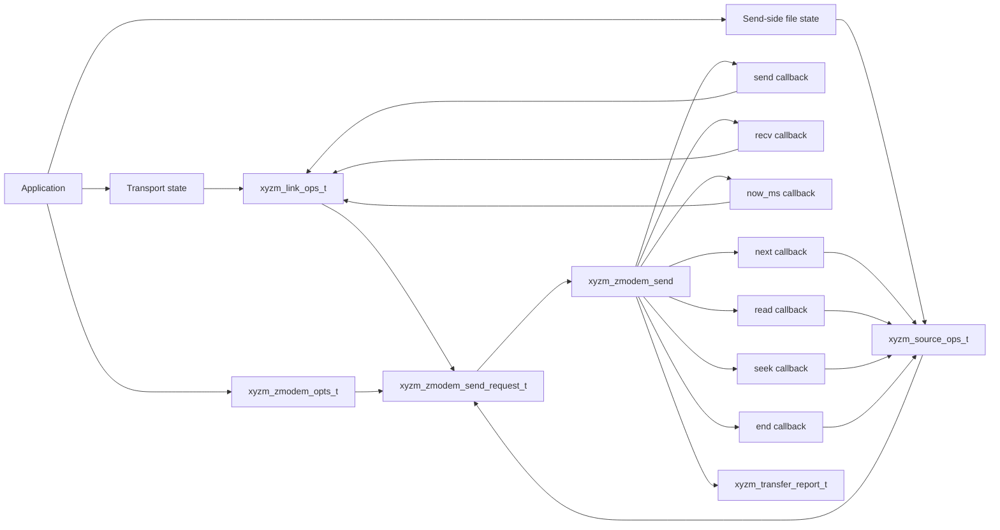
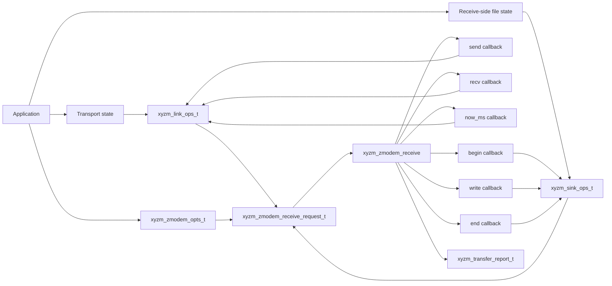

# libxyzm

A portable library implementation of X/Y/ZMODEM.

[](https://www.repostatus.org/#active)
[](https://opensource.org/licenses/MIT)

---

[(For Japanese language/日本語はこちら)](./README_ja.md)

> Please note that this English version of the document was machine-translated and then partially edited, so it may contain inaccuracies.
> We welcome pull requests to correct any errors in the text.

## What is This?

libxyzm is a portable C/C++ implementation of X/Y/ZMODEM.

It focuses on X/Y/ZMODEM protocol handling and completely separates actual I/O
from the protocol implementation. In other words, file access and communication
are kept out of the library itself. Applications provide those operations to
libxyzm as source callbacks and sink callbacks, so the library can be embedded
in many different environments.

- The [synchronous I/O version](./include/libxyzm/sync.h) controls the protocol
  through a conventional C API. Applications implement functions for file access
  and communication, then pass those function pointers to the library as
  callbacks.
- The [asynchronous I/O version](./include/libxyzm/async.h) controls the
  protocol through a C++20 API. It uses
  [cardio](https://github.com/kekyo/cardio/) to enable asynchronous processing
  with C++20 `co_await`, making async I/O code straightforward in a style similar
  to JavaScript async code.

---

## Building the Library

The libxyzm library can be built from the source code in the `src/` and `include/` directories.
Since libxyzm is designed with portability in mind to ensure it can be used in various environments,
you can import this code into your project (for example, by referencing it as a submodule in Git)
and use it.

> Note: The library contains both synchronous and asynchronous versions of the code.
> The synchronous version is an extremely clean and portable implementation,
> while the asynchronous version depends on `cardio`.
> Therefore, please note that while the synchronous version is easy to package as a library,
> the asynchronous version requires that `cardio` also be packaged as a library.

### Layout

- `include/libxyzm/`: public headers owned by libxyzm
- `src/`: protocol core and synchronous API implementation
- `deps/cardio/`: cardio 1.0.0 submodule used by the asynchronous API
- `tests/`: unit tests and integration tests for the library
- `samples/`: standalone synchronous sample programs and sample-only POSIX glue

### Public Headers

- `libxyzm/base.h`: shared public enums, file metadata, transfer options, and transfer reports
- `libxyzm/sync.h`: synchronous transport and file callback API
- `libxyzm/async.h`: C++20 asynchronous transport and file callback API

Sample-specific glue lives outside the library core.

- `tests/support/`: transport and file helpers used by the test suite
- `samples/support/`: POSIX helpers used by the samples

---

## Usage

For a minimal working example, see the
[sample CLI for simple ZMODEM send and receive](./samples/basic/).

The following sections show a minimal ZMODEM setup step by step. XMODEM and
YMODEM are used in basically the same way, with different structures and
parameters. The differences between X/Y/ZMODEM and the asynchronous API are
shown later.

### ZMODEM Send: Synchronous Version

To send data with libxyzm, define the functions that perform the required I/O.



1. Prepare `xyzm_source_ops_t` to enumerate files to send and read their
   contents. Set function pointers for `next`, `read`, `seek`, and `end`.
   `next` returns the next file metadata, `read` reads payload bytes, `seek`
   moves the read position for ZMODEM resume requests, and `end` closes the file
   handle.
2. Prepare `xyzm_link_ops_t` to send and receive bytes with the peer. This layer
   can use serial ports, TCP sockets, pipes, or custom devices, but it must pass
   raw 8-bit-clean bytes to libxyzm.
3. Build `xyzm_zmodem_opts_t` and `xyzm_zmodem_send_request_t`, then call
   `xyzm_zmodem_send()`.

#### File Read Functions

The following example configures `xyzm_source_ops_t` to send exactly one local
file. In a real application, set `path`, `name`, and `size_bytes` from the file
system or from application metadata.

```c
typedef struct app_source_state {
  /* Local file path opened by the source callback. */
  const char *path;

  /* File name announced to the peer. Usually this should be only the path leaf. */
  const char *name;

  /* Logical payload size. ZMODEM/YMODEM use this as file metadata. */
  uint64_t size_bytes;

  /* File handle opened by next and used by read/seek/end. */
  FILE *file;

  /* This example sends one file, so the second next call returns END. */
  bool used;
} app_source_state_t;

static xyzm_status_t app_source_next(
    void *opaque,
    xyzm_file_info_t *info,
    void **file_opaque) {
  /* opaque is the application state stored in xyzm_source_ops_t.opaque. */
  app_source_state_t *source = opaque;

  /* Returning END means there are no more files to send; this is a normal result. */
  if (source->used) {
    return XYZM_STATUS_END;
  }

  /* A local open failure is reported as a local I/O error, not a protocol error. */
  source->file = fopen(source->path, "rb");
  if (source->file == NULL) {
    return XYZM_STATUS_IO_ERROR;
  }

  /* valid_mask tells libxyzm which metadata fields are meaningful. */
  source->used = true;
  info->valid_mask = XYZM_FILE_INFO_NAME | XYZM_FILE_INFO_SIZE;
  info->name = source->name;
  info->size_bytes = source->size_bytes;
  info->mtime_unix_seconds = 0u;
  info->mode = 0u;

  /* file_opaque is passed back to read, seek, and end for this file. */
  *file_opaque = source;
  return XYZM_STATUS_OK;
}

static xyzm_status_t app_source_read(
    void *opaque,
    void *file_opaque,
    uint8_t *buf,
    size_t capacity,
    size_t *read_len) {
  /* file_opaque is the value returned by app_source_next. */
  app_source_state_t *source = file_opaque;

  /* This example does not need the whole source opaque value. */
  (void)opaque;

  /* Never write more than capacity bytes. Return the byte count through read_len. */
  *read_len = fread(buf, 1u, capacity, source->file);
  if (*read_len > 0u) {
    return XYZM_STATUS_OK;
  }

  /* A zero-byte read is END for EOF, or IO_ERROR for a local read failure. */
  return feof(source->file) ? XYZM_STATUS_END : XYZM_STATUS_IO_ERROR;
}

static xyzm_status_t app_source_seek(
    void *opaque,
    void *file_opaque,
    uint64_t offset) {
  /* ZMODEM uses this when the receiver requests a resume position. */
  app_source_state_t *source = file_opaque;
  (void)opaque;

  return fseek(source->file, (long)offset, SEEK_SET) == 0 ?
      XYZM_STATUS_OK :
      XYZM_STATUS_IO_ERROR;
}

static xyzm_status_t app_source_end(
    void *opaque,
    void *file_opaque,
    const xyzm_file_info_t *info,
    xyzm_status_t result) {
  /* result is the final status for this file. Success is XYZM_STATUS_OK. */
  app_source_state_t *source = file_opaque;
  (void)opaque;
  (void)info;
  (void)result;

  /* end is called for both success and failure, so release local resources here. */
  if (source->file != NULL) {
    fclose(source->file);
    source->file = NULL;
  }
  return XYZM_STATUS_OK;
}
```

#### Data Send and Receive Functions

`xyzm_link_ops_t` is the layer that reads and writes protocol frames to the
actual communication path. The following example assumes the application
provides `app_transport_send()` and `app_transport_recv()`. Those functions may
use serial ports, TCP sockets, or any other byte-stream transport.

```c
typedef struct app_link_state {
  /* Application-owned transport, such as a serial port, TCP socket, or pipe. */
  app_transport_t *transport;
} app_link_state_t;

static xyzm_status_t app_link_send(
    void *opaque,
    const uint8_t *buf,
    size_t len,
    uint32_t timeout_ms,
    size_t *written_len) {
  /* opaque is the transport state stored in xyzm_link_ops_t.opaque. */
  app_link_state_t *link = opaque;

  /* libxyzm allows partial writes. A successful callback must write at least one byte. */
  app_io_result_t result =
      app_transport_send(link->transport, buf, len, timeout_ms, written_len);

  /* Returning OK with zero bytes would violate the callback contract. */
  if (result == APP_IO_OK && *written_len > 0u) {
    return XYZM_STATUS_OK;
  }
  /* Keep timeout and cancellation separate from generic I/O failures. */
  if (result == APP_IO_TIMEOUT) {
    return XYZM_STATUS_TIMEOUT;
  }
  if (result == APP_IO_CANCELLED) {
    return XYZM_STATUS_CANCELLED;
  }
  return XYZM_STATUS_IO_ERROR;
}

static xyzm_status_t app_link_recv(
    void *opaque,
    uint8_t *buf,
    size_t capacity,
    uint32_t timeout_ms,
    size_t *read_len) {
  app_link_state_t *link = opaque;

  /* recv may also return a partial read. A successful callback returns at least one byte. */
  app_io_result_t result =
      app_transport_recv(link->transport, buf, capacity, timeout_ms, read_len);

  /* Treat a zero-byte read as a transport failure for this byte-stream API. */
  if (result == APP_IO_OK && *read_len > 0u) {
    return XYZM_STATUS_OK;
  }
  if (result == APP_IO_TIMEOUT) {
    return XYZM_STATUS_TIMEOUT;
  }
  if (result == APP_IO_CANCELLED) {
    return XYZM_STATUS_CANCELLED;
  }
  return XYZM_STATUS_IO_ERROR;
}

static uint64_t app_link_now_ms(void *opaque) {
  (void)opaque;

  /* libxyzm uses this monotonic clock for timeout calculations. */
  return app_monotonic_time_ms();
}
```

#### Start ZMODEM Send

Set the functions defined above as function pointers in their respective
structures, then call `xyzm_zmodem_send()`. `xyzm_zmodem_send()` is synchronous,
so it occupies the calling thread until the transfer completes.

```c
/* link_state/source_state/options/request/report must remain alive during the transfer. */
app_link_state_t link_state = {transport};

/* Register the send, recv, and now_ms callbacks used by libxyzm. */
xyzm_link_ops_t link = {
    &link_state,
    app_link_send,
    app_link_recv,
    app_link_now_ms};

/* Store the file path and metadata used by the source callbacks. */
app_source_state_t source_state = {
    local_path,
    file_name,
    file_size,
    NULL,
    false};

/* Register callbacks that enumerate, read, reposition, and close the source file. */
xyzm_source_ops_t source = {
    &source_state,
    app_source_next,
    app_source_read,
    app_source_seek,
    app_source_end};

/* Tune timeout and retry values for the peer device and link latency in real applications. */
xyzm_zmodem_opts_t options = {
    5000u,  /* handshake_timeout_ms: wait time for the initial transfer handshake */
    5000u,  /* block_timeout_ms: wait time for block-level send/receive progress */
    8u,     /* retry_limit: maximum retries after timeout or retransmission */
    0x1au,  /* pad_byte: byte used to pad the end of a block */
    0u,     /* zmodem_packet_len: 0 means the library default */
    1u,     /* zmodem_escape_ctrl: enable additional control-character escaping */
    1u};    /* zmodem_use_crc32: prefer CRC32 FCS */

/* The request bundles the transport, source, options, and optional observer. */
xyzm_zmodem_send_request_t request = {
    &link,
    &source,
    &options,
    NULL};

/* report receives the final status, payload bytes, completed files, and retry count. */
xyzm_transfer_report_t report;

/* Start the synchronous transfer. This call returns only after the transfer finishes. */
xyzm_status_t status = xyzm_zmodem_send(&request, &report);
if (status != XYZM_STATUS_OK) {
  /* Use report.final_status, retry_count, and related fields for logging. */
}
```

### ZMODEM Receive: Synchronous Version

To receive data with libxyzm, define the functions that perform the required
I/O.



1. As with sending, prepare `xyzm_link_ops_t` to send and receive bytes with the
   peer. The protocol controls the communication direction, so the `send` and
   `recv` implementations for serial ports or TCP sockets can usually be reused
   almost unchanged from the send path.
2. Prepare `xyzm_sink_ops_t` to create the received file and write payload bytes.
   `begin` opens the receive-side file, `write` writes received data, and `end`
   closes the file.
3. Build `xyzm_zmodem_opts_t` and `xyzm_zmodem_receive_request_t`, then call
   `xyzm_zmodem_receive()`.

#### Data Send and Receive Functions

The receive side uses the same `xyzm_link_ops_t` shape. You can reuse
`app_link_send()`, `app_link_recv()`, and `app_link_now_ms()` shown in the send
section.

```c
/* Receive uses the same transport callback registration as send. */
app_link_state_t link_state = {transport};
xyzm_link_ops_t link = {
    &link_state,
    app_link_send,
    app_link_recv,
    app_link_now_ms};
```

#### File Output Functions

On receive, file names and sizes announced by the protocol are passed as
`xyzm_file_info_t`. XMODEM may not provide a file name, so prepare a fallback
file name on the application side when needed.

```c
typedef struct app_sink_state {
  /* Directory where received files are written. */
  const char *output_dir;

  /* Fallback name used when the protocol does not announce a file name. */
  const char *fallback_name;

  /* Output file opened by begin and used by write/end. */
  FILE *file;

  /* Full output path, kept so end can remove partial files on failure. */
  char path[1024];
} app_sink_state_t;

static const char *app_path_leaf(const char *path) {
  /* Avoid using peer-provided directory components directly in the output path. */
  const char *slash = strrchr(path, '/');
  return slash != NULL ? slash + 1 : path;
}

static const char *app_received_file_name(
    const xyzm_file_info_t *info,
    const char *fallback_name) {
  /* Use info->name only when the valid_mask says the name field is present. */
  if ((info->valid_mask & XYZM_FILE_INFO_NAME) != 0u &&
      info->name != NULL &&
      info->name[0] != '\0') {
    return app_path_leaf(info->name);
  }
  return fallback_name;
}

static xyzm_status_t app_sink_begin(
    void *opaque,
    const xyzm_file_info_t *info,
    uint64_t *resume_offset,
    void **file_opaque) {
  /* opaque is the receive-side state stored in xyzm_sink_ops_t.opaque. */
  app_sink_state_t *sink = opaque;
  const char *name = app_received_file_name(info, sink->fallback_name);

  /* This example writes directly to output_dir/name. Real applications should define overwrite policy. */
  int path_len =
      snprintf(sink->path, sizeof(sink->path), "%s/%s", sink->output_dir, name);
  if (path_len < 0 || (size_t)path_len >= sizeof(sink->path)) {
    return XYZM_STATUS_UNSUPPORTED;
  }

  /* Local file creation failures are reported as local I/O errors. */
  sink->file = fopen(sink->path, "wb");
  if (sink->file == NULL) {
    return XYZM_STATUS_IO_ERROR;
  }

  /* Return zero when this sink does not resume partial ZMODEM receives. */
  *resume_offset = 0u;

  /* file_opaque is passed back to write and end for this receive-side file. */
  *file_opaque = sink;
  return XYZM_STATUS_OK;
}

static xyzm_status_t app_sink_write(
    void *opaque,
    void *file_opaque,
    const uint8_t *buf,
    size_t len) {
  /* buf contains payload bytes after protocol framing has been removed. */
  app_sink_state_t *sink = file_opaque;
  (void)opaque;

  /* The sink accepts the chunk only if all len bytes were written. */
  return fwrite(buf, 1u, len, sink->file) == len ?
      XYZM_STATUS_OK :
      XYZM_STATUS_IO_ERROR;
}

static xyzm_status_t app_sink_end(
    void *opaque,
    void *file_opaque,
    const xyzm_file_info_t *info,
    xyzm_status_t result) {
  /* result tells whether this file completed successfully. */
  app_sink_state_t *sink = file_opaque;
  (void)opaque;
  (void)info;

  /* end is called even after failure, so always close the output file here. */
  if (sink->file != NULL) {
    fclose(sink->file);
    sink->file = NULL;
  }
  if (result != XYZM_STATUS_OK) {
    remove(sink->path);
  }
  return XYZM_STATUS_OK;
}
```

#### Start ZMODEM Receive

`xyzm_zmodem_receive()` is also synchronous. The destination path and partial
file policy are controlled by the `xyzm_sink_ops_t` implementation.

```c
/* sink_state/sink/options/request/report must remain valid until receive returns. */
app_sink_state_t sink_state = {
    output_dir,
    "received.bin",
    NULL,
    {0}};

/* Register callbacks used to begin, write, and finalize each received file. */
xyzm_sink_ops_t sink = {
    &sink_state,
    app_sink_begin,
    app_sink_write,
    app_sink_end};

/* Use ZMODEM settings compatible with the sender and transport path. */
xyzm_zmodem_opts_t options = {
    5000u,  /* handshake_timeout_ms: wait time for the initial transfer handshake */
    5000u,  /* block_timeout_ms: wait time for block-level send/receive progress */
    8u,     /* retry_limit: maximum retries after timeout or retransmission */
    0x1au,  /* pad_byte: byte used to pad the end of a block */
    0u,     /* zmodem_packet_len: 0 means the library default */
    1u,     /* zmodem_escape_ctrl: enable additional control-character escaping */
    1u};    /* zmodem_use_crc32: prefer CRC32 FCS */

/* The request bundles the transport, sink, options, and optional observer. */
xyzm_zmodem_receive_request_t request = {
    &link,
    &sink,
    &options,
    NULL};

xyzm_transfer_report_t report;

/* Start the synchronous receive. This call returns only after receive finishes. */
xyzm_status_t status = xyzm_zmodem_receive(&request, &report);
if (status != XYZM_STATUS_OK) {
  /* Use report.final_status, payload_bytes, and related fields for logging. */
}
```

### Asynchronous Version

The asynchronous version uses cardio to provide natural C++20 `co_await` based
implementations. The following example shows ZMODEM send.

#### File Read Functions

In the asynchronous API, source callbacks return `cardio::promise<T>`. The
following is a minimal example that sends in-memory data as one file.

```cpp
struct app_async_source_state {
  // Metadata announced to the peer.
  xyzm_async_file_info_t info;

  // This example sends bytes from memory instead of a file.
  std::vector<uint8_t> data;

  // Next byte offset to read. seek may update this value.
  std::size_t offset = 0;

  // This example sends one file, so the second next call returns end.
  bool used = false;
};

xyzm_async_source_ops_t make_async_source(app_async_source_state &state) {
  // Keep this callback table alive until the asynchronous transfer completes.
  xyzm_async_source_ops_t source;

  source.next =
      [&state](
          xyzm_async_file_info_t &info,
          cardio::cancellation cancellation) -> cardio::promise<xyzm_async_status_t> {
    // Async callbacks should observe cancellation before waiting or doing long work.
    cancellation.throw_if_cancellation_requested();
    if (state.used) {
      co_return xyzm_async_status_t::end;
    }

    // Copy metadata into info and expose this one file to libxyzm.
    state.used = true;
    info = state.info;
    co_return xyzm_async_status_t::ok;
  };

  source.read =
      [&state](
          std::span<uint8_t> buf,
          std::size_t &read_len,
          cardio::cancellation cancellation) -> cardio::promise<xyzm_async_status_t> {
    cancellation.throw_if_cancellation_requested();

    // No remaining bytes means this file reached its natural end.
    const auto remain = state.data.size() - state.offset;
    if (remain == 0u) {
      read_len = 0u;
      co_return xyzm_async_status_t::end;
    }

    // Copy at most the buffer capacity provided by libxyzm.
    const auto copy_len = std::min(remain, buf.size());
    std::copy_n(state.data.data() + state.offset, copy_len, buf.data());
    state.offset += copy_len;
    read_len = copy_len;
    co_return xyzm_async_status_t::ok;
  };

  source.seek =
      [&state](uint64_t offset, cardio::cancellation cancellation) -> cardio::promise<void> {
    cancellation.throw_if_cancellation_requested();

    // ZMODEM uses this to resume from the position requested by the receiver.
    if (offset > state.data.size()) {
      throw xyzm_async_io_error("source seek failed");
    }
    state.offset = static_cast<std::size_t>(offset);
    co_return;
  };

  source.end =
      [](const xyzm_async_file_info_t &,
          std::exception_ptr,
          cardio::cancellation cancellation) -> cardio::promise<void> {
    cancellation.throw_if_cancellation_requested();

    // There is nothing to release for an in-memory source. Close files here in file-backed sources.
    co_return;
  };

  return source;
}
```

#### Data Send and Receive Functions

The asynchronous transport also provides the same three concepts as the
synchronous version: send, receive, and monotonic time. The following example
assumes the application has `async_send()` and `async_recv()` operations that can
be awaited.

```cpp
struct app_async_link_state {
  // Application-owned asynchronous transport object.
  app_async_transport *transport = nullptr;
};

xyzm_async_link_ops_t make_async_link(app_async_link_state &state) {
  // send/recv return cardio::promise<void> and report byte counts through references.
  xyzm_async_link_ops_t link;

  link.send =
      [&state](
          std::span<const uint8_t> buf,
          uint32_t timeout_ms,
          std::size_t &written_len,
          cardio::cancellation cancellation) -> cardio::promise<void> {
    // async_send should honor timeout_ms and cancellation while waiting for progress.
    written_len = co_await state.transport->async_send(buf, timeout_ms, cancellation);
    if (written_len == 0u) {
      throw xyzm_async_io_error("transport send failed");
    }
    co_return;
  };

  link.recv =
      [&state](
          std::span<uint8_t> buf,
          uint32_t timeout_ms,
          std::size_t &read_len,
          cardio::cancellation cancellation) -> cardio::promise<void> {
    // A successful recv must return at least one byte. Zero bytes are treated as a transport error.
    read_len = co_await state.transport->async_recv(buf, timeout_ms, cancellation);
    if (read_len == 0u) {
      throw xyzm_async_io_error("transport receive failed");
    }
    co_return;
  };

  link.now_ms = []() -> uint64_t {
    // now_ms is a synchronous callback and must return monotonic time.
    return app_monotonic_time_ms();
  };

  return link;
}
```

#### Start ZMODEM Send

For the asynchronous API, the request, options, callback tables, and report must
remain alive until the returned `cardio::promise<T>` completes.

```cpp
cardio::promise<xyzm_async_transfer_report_t> run_zmodem_send_async(
    xyzm_async_link_ops_t &link,
    xyzm_async_source_ops_t &source,
    cardio::cancellation cancellation) {
  // options/request/report must remain alive across co_await, so keep them in this coroutine.
  xyzm_zmodem_opts_t options{
      5000u,  // handshake_timeout_ms: wait time for the initial transfer handshake
      5000u,  // block_timeout_ms: wait time for block-level send/receive progress
      8u,     // retry_limit: maximum retries after timeout or retransmission
      0x1au,  // pad_byte: byte used to pad the end of a block
      0u,     // zmodem_packet_len: 0 means the library default
      1u,     // zmodem_escape_ctrl: enable additional control-character escaping
      1u};    // zmodem_use_crc32: prefer CRC32 FCS

  // The asynchronous request layout mirrors the synchronous request layout.
  xyzm_zmodem_send_async_request_t request{
      &link,
      &source,
      &options,
      nullptr};

  xyzm_async_transfer_report_t report{};

  // Failures are reported as xyzm_async_error-derived exceptions; catch them at the call site if needed.
  co_await xyzm_zmodem_send_async(&request, &report, cancellation);
  co_return report;
}
```

cardio manages asynchronous continuations, meaning the execution of code after
`co_await`, through a cardio dispatcher.

libxyzm does not manage the cardio dispatcher. Dispatcher initialization and
parking must be managed by the application. See the
[cardio documentation](https://github.com/kekyo/cardio/) for details.

### Definition Differences Between X/Y/ZMODEM

The transport callback table is always `xyzm_link_ops_t` in the synchronous API
and `xyzm_async_link_ops_t` in the asynchronous API. Sending combines the link
with a source. Receiving combines the link with a sink.

| Protocol | Direction | File I/O | Options type | Request type | Synchronous function |
|:--- |:--- |:--- |:--- |:--- |:--- |
| XMODEM | Send | `xyzm_source_ops_t` | `xyzm_xmodem_send_opts_t` | `xyzm_xmodem_send_request_t` | `xyzm_xmodem_send()` |
| XMODEM | Receive | `xyzm_sink_ops_t` | `xyzm_xmodem_receive_opts_t` | `xyzm_xmodem_receive_request_t` | `xyzm_xmodem_receive()` |
| YMODEM | Send | `xyzm_source_ops_t` | `xyzm_ymodem_opts_t` | `xyzm_ymodem_send_request_t` | `xyzm_ymodem_send()` / `xyzm_ymodem_send_batch()` |
| YMODEM | Receive | `xyzm_sink_ops_t` | `xyzm_ymodem_opts_t` | `xyzm_ymodem_receive_request_t` | `xyzm_ymodem_receive()` / `xyzm_ymodem_receive_batch()` |
| ZMODEM | Send | `xyzm_source_ops_t` | `xyzm_zmodem_opts_t` | `xyzm_zmodem_send_request_t` | `xyzm_zmodem_send()` / `xyzm_zmodem_send_batch()` |
| ZMODEM | Receive | `xyzm_sink_ops_t` | `xyzm_zmodem_opts_t` | `xyzm_zmodem_receive_request_t` | `xyzm_zmodem_receive()` / `xyzm_zmodem_receive_batch()` |

| Protocol | Direction | File I/O | Request type | Asynchronous function |
|:--- |:--- |:--- |:--- |:--- |
| XMODEM | Send | `xyzm_async_source_ops_t` | `xyzm_xmodem_send_async_request_t` | `xyzm_xmodem_send_async()` |
| XMODEM | Receive | `xyzm_async_sink_ops_t` | `xyzm_xmodem_receive_async_request_t` | `xyzm_xmodem_receive_async()` |
| YMODEM | Send | `xyzm_async_source_ops_t` | `xyzm_ymodem_send_async_request_t` | `xyzm_ymodem_send_async()` / `xyzm_ymodem_send_batch_async()` |
| YMODEM | Receive | `xyzm_async_sink_ops_t` | `xyzm_ymodem_receive_async_request_t` | `xyzm_ymodem_receive_async()` / `xyzm_ymodem_receive_batch_async()` |
| ZMODEM | Send | `xyzm_async_source_ops_t` | `xyzm_zmodem_send_async_request_t` | `xyzm_zmodem_send_async()` / `xyzm_zmodem_send_batch_async()` |
| ZMODEM | Receive | `xyzm_async_sink_ops_t` | `xyzm_zmodem_receive_async_request_t` | `xyzm_zmodem_receive_async()` / `xyzm_zmodem_receive_batch_async()` |

XMODEM is basically a single-file transfer and its wire format does not carry a
file name or original size. YMODEM and ZMODEM can carry file metadata, so
applications can use `name` and `size_bytes` in `xyzm_file_info_t` or
`xyzm_async_file_info_t`.

The main parameters in each protocol option type are as follows.

| Target | Parameter | Meaning |
|:--- |:--- |:--- |
| Common | `handshake_timeout_ms` | Timeout while waiting for transfer-start handshakes. |
| Common | `block_timeout_ms` | Timeout used for block-level send/receive progress and response waits. |
| Common | `retry_limit` | Maximum number of retries allowed after timeouts or retransmissions. |
| Common | `pad_byte` | Byte value used to pad outbound data that does not fill a complete block. |
| `xyzm_xmodem_send_opts_t` | `checksum_mode` | `XYZM_XMODEM_CHECKSUM_MODE_CHECKSUM` uses an 8-bit checksum, `XYZM_XMODEM_CHECKSUM_MODE_CRC` uses CRC16, and `XYZM_XMODEM_CHECKSUM_MODE_AUTO` chooses from the receiver start request. |
| `xyzm_xmodem_receive_opts_t` | `checksum_mode` | Verification method requested by the receiver. On receive, specify `CHECKSUM` or `CRC` explicitly instead of `AUTO`. |
| `xyzm_xmodem_send_opts_t` | `packet_size` | `XYZM_XMODEM_PACKET_SIZE_128` uses 128-byte blocks, while `XYZM_XMODEM_PACKET_SIZE_1K` prefers 1024-byte blocks. |
| `xyzm_ymodem_opts_t` | `variant` | `XYZM_YMODEM_VARIANT_STANDARD` is normal YMODEM, and `XYZM_YMODEM_VARIANT_G` is streaming YMODEM-g. Send can use `AUTO` to choose from the peer request, while receive requires an explicit variant. |
| `xyzm_zmodem_opts_t` | `zmodem_packet_len` | Preferred ZMODEM subpacket size. `0` means the default, and the implementation clamps values into the 32 to 1024 byte range. |
| `xyzm_zmodem_opts_t` | `zmodem_escape_ctrl` | When nonzero, ZMODEM send escapes control characters more aggressively. Use this when terminals or intermediate links may interpret control characters. |
| `xyzm_zmodem_opts_t` | `zmodem_use_crc32` | When nonzero, ZMODEM prefers CRC32 FCS. When zero, it uses the CRC16 form. |

---

## Build overall source code in the repository

You can build all the code in the repository by following these steps.

Clone the repository together with its submodules:

```bash
$ git clone --recurse-submodules https://github.com/kekyo/libxyzm.git
```

For an existing checkout, initialize or update the submodules:

```bash
$ git submodule update --init --recursive
```

On Ubuntu 24.04 or later:

```bash
$ sudo dpkg --add-architecture i386
$ sudo apt update
$ sudo apt install \
    build-essential \
    nodejs \
    gcc-mingw-w64 \
    wine \
    wine64 \
    wine32:i386
```

To build and test the whole matrix from this directory:

```bash
$ ./build.sh
```

### Outputs

On POSIX builds, `make all` produces:

- `build/libxyzm.a`
- `build/libxyzm.so`
- `build/libxyzm_async.a`
- `build/libxyzm_async.so`

On Win32 builds, `make all TARGET_OS=win32 ...` produces:

- `build/<compiler>/libxyzm.a`
- `build/<compiler>/libxyzm.dll`
- `build/<compiler>/libxyzm.dll.a`
- `build/<compiler>/libxyzm_async.a`
- `build/<compiler>/libxyzm_async.dll`
- `build/<compiler>/libxyzm_async.dll.a`

### Packaging

Install the packaging prerequisites on the host:

```bash
$ sudo apt install podman qemu-user-static zip \
    gcc-mingw-w64 \
    dpkg-dev
```

`build_pack.sh` resolves the package version with [screw-up-native](https://github.com/kekyo/screw-up-native/) when `--version`
is not supplied. If screw-up-native is not installed, pass the version explicitly.

Prepare the Linux container images first. This step installs the package build
dependencies into target-specific podman images, so package builds do not repeat
the slow dependency setup work:

```bash
$ ./prereq.sh
```

Then generate all supported artifacts:

```bash
$ ./build_pack.sh --version 0.1.0
```

The Debian/Ubuntu matrix uses the official images that directly provide the
target platform:

- Debian bookworm: `amd64`, `i686`, `arm64`, `armv7l`
- Debian trixie: `amd64`, `i686`, `arm64`, `armv7l`, `riscv64`
- Ubuntu 22.04 and 24.04: `amd64`, `arm64`, `armv7l`, `riscv64`

This generates:

- Debian packages containing `libxyzm.so`, `libxyzm.a`,
  `libxyzm_async.so`, `libxyzm_async.a`, and `include/libxyzm/*.h`
- Win32 zip packages for `x86` and `x64` containing DLLs, import libraries,
  static libraries, and `include/libxyzm/*.h`

Artifacts are written under `artifacts/`. Use `--jobs <count>` to cap
concurrent package builds, and `--distro`, `--release`, or `--arch` to build a
subset.

## License

MIT License.
