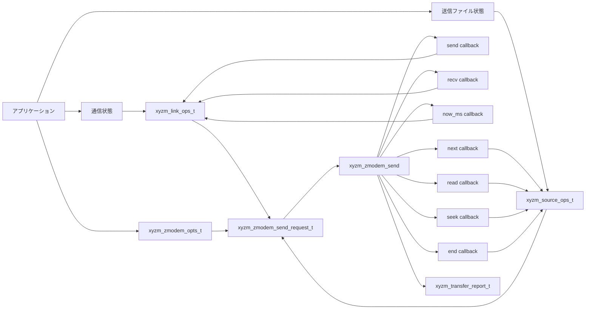
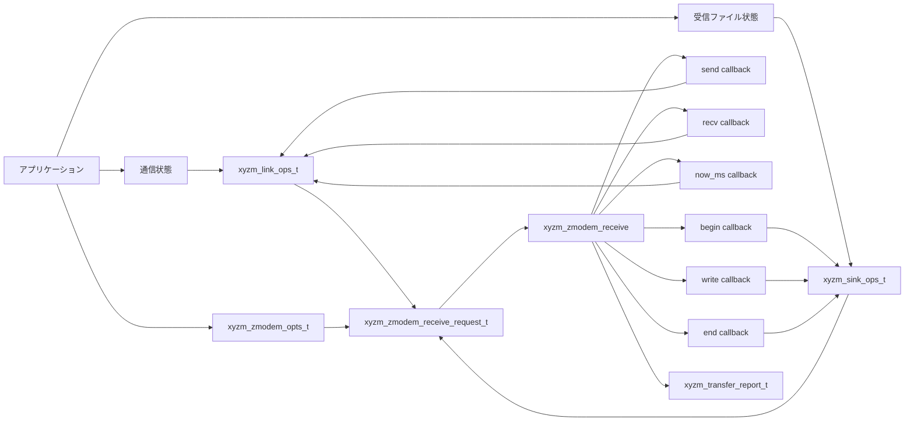

# libxyzm

X/Y/ZMODEM のポータブルなライブラリ実装

[](https://www.repostatus.org/#active)
[](https://opensource.org/licenses/MIT)

---

[(English is here)](./README.md)

## これは何?

X/Y/ZMODEMのC/C++によるポータブルな実装です。

X/Y/ZMODEMのプロトコル処理に特化して、実際のI/O処理を完全に分離しています。
つまり、ファイルアクセスや通信などをライブラリから完全に排除しています。
それらは「ソースコールバック」と「シンクコールバック」としてlibxyzmに渡すことで、
任意の環境でこのライブラリを組み込んで使用できるはずです。

- [同期I/Oバージョン](./include/libxyzm/sync.h) では、一般的なC言語APIによるプロトコル制御を行います。
  ユーザーはファイルアクセスや通信を行う関数を実装して、その関数ポインタをコールバックとしてライブラリに差し込んで使用します。
- [非同期I/Oバージョン](./include/libxyzm/async.h) では、C++20 APIによるプロトコル制御を行います。
  これは [cardio](https://github.com/kekyo/cardio/) を使用して C++20の `co_await` を使用した非同期処理を可能にすることで、
  非同期I/O処理でありながら、JavaScriptのような簡便な非同期処理を実装できます。

---

## ライブラリのビルド

libxyzmライブラリは、 `src/` ディレクトリと `include/` ディレクトリのソースコードからビルドできます。
libxyzmは、様々な環境で使用できるように、ポータブル性を重視して設計しているため、
あなたのプロジェクトにこれらのコードをインポートして（例えばGitでsubmoduleで参照するなどして）、
使用することが出来ます。

> 注意: ライブラリ内には、同期バージョンと非同期バージョンのコードが含まれていて、
> 同期バージョンは、極めてクリーンなポータブル実装となっていますが、
> 非同期バージョンは、 `cardio` に依存しています。
> そのため、同期バージョンはライブラリ化も容易ですが、非同期バージョンについては `cardio` のライブラリ化も行う必要があることに注意してください。

### 構成

- `include/libxyzm/`: libxyzm が所有する公開ヘッダー
- `src/`: プロトコルコアと同期 API 実装
- `deps/cardio/`: 非同期 API が使用する cardio 0.2.0 submodule
- `tests/`: ライブラリの unit test と integration test
- `samples/`: スタンドアロンの同期サンプルプログラムとサンプル専用 POSIX glue

### 公開ヘッダー

- `libxyzm/base.h`: 共通の公開 enum、file metadata、transfer options、transfer reports
- `libxyzm/sync.h`: 同期 transport と file callback API
- `libxyzm/async.h`: C++20 非同期 transport と file callback API

サンプル専用の glue は、ライブラリコアの外にあります。

- `tests/support/`: test suite が使用する transport と file helper
- `samples/support/`: sample が使用する POSIX helper

---

## 使用方法

最小構成の例として、 [ZMODEMによる単純な送受信を行うCLIのサンプル](./samples/basic/) があるので参照して下さい。

以下では、ZMODEMについて最小構成を順に行う例を示します。
X/YMODEMについても、使用する構造体やパラメータなどが異なるだけで、基本的に同じ方法で使用できます。
X/Y/ZMODEMの差異や、非同期バージョンの扱いは、後の章で示します。

### ZMODEM送信（同期バージョン）

libxyzmでデータ送信を実現するには、入出力を行う各関数を定義する必要があります。



1. 送信するファイルを列挙し、ファイル内容を読み出す `xyzm_source_ops_t` を用意します。
   `next` は次のファイル情報を返し、`read` はペイロードを読み込み、`seek` はZMODEMの再開要求に応じて読み取り位置を移動し、`end` はファイルハンドルを閉じる関数へのポインタをそれぞれセットします。
2. 相手側とバイト列を送受信する `xyzm_link_ops_t` を用意します。
   この層はシリアルポート、TCPソケット、pipe、独自デバイスなどを扱えますが、libxyzmには生の8bit cleanなバイト列だけを渡します。
3. `xyzm_zmodem_opts_t` と `xyzm_zmodem_send_request_t` を組み立て、`xyzm_zmodem_send()` を呼び出します。

#### ファイルを読み取る関数

次の例では、1つのローカルファイルだけを送信する `xyzm_source_ops_t` を構成しています。
実際のアプリケーションでは、`path`、`name`、`size_bytes` をファイルシステムやアプリケーションのメタデータから設定してください。

```c
typedef struct app_source_state {
  /* 実際に開くローカルファイルのパスです。 */
  const char *path;

  /* 相手側へ通知するファイル名です。通常はパスの末尾要素だけを使います。 */
  const char *name;

  /* 送信するペイロードの論理サイズです。ZMODEM/YMODEMではメタデータとして使われます。 */
  uint64_t size_bytes;

  /* nextで開き、read/seek/endで使うファイルハンドルです。 */
  FILE *file;

  /* この例は1ファイルだけ送るので、2回目のnextでENDを返すために使います。 */
  bool used;
} app_source_state_t;

static xyzm_status_t app_source_next(
    void *opaque,
    xyzm_file_info_t *info,
    void **file_opaque) {
  /* opaqueはxyzm_source_ops_t.opaqueに設定したアプリケーション側の状態です。 */
  app_source_state_t *source = opaque;

  /* 送るファイルがもう無ければENDを返します。これは正常終了扱いです。 */
  if (source->used) {
    return XYZM_STATUS_END;
  }

  /* ファイルを開けない場合は、プロトコルエラーではなくローカルI/Oエラーとして返します。 */
  source->file = fopen(source->path, "rb");
  if (source->file == NULL) {
    return XYZM_STATUS_IO_ERROR;
  }

  /* valid_maskで、どのメタデータフィールドが有効かを明示します。 */
  source->used = true;
  info->valid_mask = XYZM_FILE_INFO_NAME | XYZM_FILE_INFO_SIZE;
  info->name = source->name;
  info->size_bytes = source->size_bytes;
  info->mtime_unix_seconds = 0u;
  info->mode = 0u;

  /* file_opaqueは、このファイルに対するread/seek/endへそのまま渡されます。 */
  *file_opaque = source;
  return XYZM_STATUS_OK;
}

static xyzm_status_t app_source_read(
    void *opaque,
    void *file_opaque,
    uint8_t *buf,
    size_t capacity,
    size_t *read_len) {
  /* file_opaqueはapp_source_nextで設定した値です。 */
  app_source_state_t *source = file_opaque;

  /* この例ではsource全体のopaqueを使わないため、未使用警告を避けています。 */
  (void)opaque;

  /* capacityを超えて書き込んではいけません。読み取ったバイト数をread_lenへ返します。 */
  *read_len = fread(buf, 1u, capacity, source->file);
  if (*read_len > 0u) {
    return XYZM_STATUS_OK;
  }

  /* 0バイト読み取りは、EOFならEND、読み取り失敗ならIO_ERRORとして区別します。 */
  return feof(source->file) ? XYZM_STATUS_END : XYZM_STATUS_IO_ERROR;
}

static xyzm_status_t app_source_seek(
    void *opaque,
    void *file_opaque,
    uint64_t offset) {
  /* ZMODEMでは受信側が途中再開位置を要求するため、送信元をその位置へ移動します。 */
  app_source_state_t *source = file_opaque;
  (void)opaque;

  return fseek(source->file, (long)offset, SEEK_SET) == 0 ?
      XYZM_STATUS_OK :
      XYZM_STATUS_IO_ERROR;
}

static xyzm_status_t app_source_end(
    void *opaque,
    void *file_opaque,
    const xyzm_file_info_t *info,
    xyzm_status_t result) {
  /* resultには、このファイルの転送結果が渡されます。成功時はXYZM_STATUS_OKです。 */
  app_source_state_t *source = file_opaque;
  (void)opaque;
  (void)info;
  (void)result;

  /* endは成功時も失敗時も呼ばれるので、ここで必ずローカルリソースを解放します。 */
  if (source->file != NULL) {
    fclose(source->file);
    source->file = NULL;
  }
  return XYZM_STATUS_OK;
}
```

#### データ送受信関数

`xyzm_link_ops_t` は、プロトコルのフレームを実際の通信路へ読み書きする層です。
以下は、アプリケーション側に `app_transport_send()` と `app_transport_recv()` があると仮定した例です。
これらの関数の内部は、シリアルポートでもTCPソケットでも構いません。

```c
typedef struct app_link_state {
  /* シリアルポート、TCPソケット、pipeなど、アプリケーション側の通信オブジェクトです。 */
  app_transport_t *transport;
} app_link_state_t;

static xyzm_status_t app_link_send(
    void *opaque,
    const uint8_t *buf,
    size_t len,
    uint32_t timeout_ms,
    size_t *written_len) {
  /* opaqueはxyzm_link_ops_t.opaqueに設定した通信状態です。 */
  app_link_state_t *link = opaque;

  /* libxyzmは部分書き込みを許容します。成功時は1バイト以上を書き込んでください。 */
  app_io_result_t result =
      app_transport_send(link->transport, buf, len, timeout_ms, written_len);

  /* XYZM_STATUS_OKで0バイトはAPI契約違反なので、0バイトはエラー扱いにします。 */
  if (result == APP_IO_OK && *written_len > 0u) {
    return XYZM_STATUS_OK;
  }
  /* タイムアウトとキャンセルは、I/Oエラーと分けて返すと上位で扱いやすくなります。 */
  if (result == APP_IO_TIMEOUT) {
    return XYZM_STATUS_TIMEOUT;
  }
  if (result == APP_IO_CANCELLED) {
    return XYZM_STATUS_CANCELLED;
  }
  return XYZM_STATUS_IO_ERROR;
}

static xyzm_status_t app_link_recv(
    void *opaque,
    uint8_t *buf,
    size_t capacity,
    uint32_t timeout_ms,
    size_t *read_len) {
  app_link_state_t *link = opaque;

  /* recvも部分読み取りを許容します。成功時は1バイト以上をread_lenに設定します。 */
  app_io_result_t result =
      app_transport_recv(link->transport, buf, capacity, timeout_ms, read_len);

  /* 0バイト読み取りは、EOFではなく通信路の異常として扱います。 */
  if (result == APP_IO_OK && *read_len > 0u) {
    return XYZM_STATUS_OK;
  }
  if (result == APP_IO_TIMEOUT) {
    return XYZM_STATUS_TIMEOUT;
  }
  if (result == APP_IO_CANCELLED) {
    return XYZM_STATUS_CANCELLED;
  }
  return XYZM_STATUS_IO_ERROR;
}

static uint64_t app_link_now_ms(void *opaque) {
  (void)opaque;

  /* プロトコルのタイムアウト計算に使うため、単調増加する時刻を返します。 */
  return app_monotonic_time_ms();
}
```

#### ZMODEM送信を開始

ここまでに定義した関数群を、それぞれの構造体に関数ポインタとして設定して、 `xyzm_zmodem_send()` を呼び出します。
`xyzm_zmodem_send()` は同期関数なので、転送が完了するまで呼び出し元のスレッドを占有します。

```c
/* link_state/source_state/options/request/reportは転送中ずっと生存している必要があります。 */
app_link_state_t link_state = {transport};

/* libxyzmが通信するためのsend/recv/now_msを登録します。 */
xyzm_link_ops_t link = {
    &link_state,
    app_link_send,
    app_link_recv,
    app_link_now_ms};

/* 送信対象ファイルと、そのメタデータを保持します。 */
app_source_state_t source_state = {
    local_path,
    file_name,
    file_size,
    NULL,
    false};

/* libxyzmが送信元ファイルを列挙・読み取り・再配置・終了するための関数を登録します。 */
xyzm_source_ops_t source = {
    &source_state,
    app_source_next,
    app_source_read,
    app_source_seek,
    app_source_end};

/* 実運用では通信路の遅延や相手機器に合わせてtimeout/retryを調整してください。 */
xyzm_zmodem_opts_t options = {
    5000u,  /* handshake_timeout_ms: 転送開始時の応答待ち時間 */
    5000u,  /* block_timeout_ms: ブロック単位の送受信待ち時間 */
    8u,     /* retry_limit: タイムアウト時などの最大リトライ回数 */
    0x1au,  /* pad_byte: ブロック末尾を埋めるバイト */
    0u,     /* zmodem_packet_len: 0ならライブラリ既定値 */
    1u,     /* zmodem_escape_ctrl: 制御文字の追加エスケープを有効化 */
    1u};    /* zmodem_use_crc32: CRC32 FCSを優先 */

/* requestは、通信路、送信元、オプション、任意のobserverを1つにまとめます。 */
xyzm_zmodem_send_request_t request = {
    &link,
    &source,
    &options,
    NULL};

/* reportには最終ステータス、転送バイト数、完了ファイル数、リトライ回数が入ります。 */
xyzm_transfer_report_t report;

/* ここで同期転送を開始します。この呼び出しは転送完了まで戻りません。 */
xyzm_status_t status = xyzm_zmodem_send(&request, &report);
if (status != XYZM_STATUS_OK) {
  /* report.final_status, retry_count などを使って失敗内容を記録します。 */
}
```

### ZMODEM受信（同期バージョン）

libxyzmでデータ受信を実現するには、入出力を行う各関数を定義する必要があります。



1. 送信時と同じく、相手側とバイト列を送受信する `xyzm_link_ops_t` を用意します。
   通信方向はプロトコルが制御するため、シリアルポートやTCPソケットを扱う `send` / `recv` 実装は送信時のものをほぼそのまま再利用できます。
2. 受信したファイルを作成し、ペイロードを書き込む `xyzm_sink_ops_t` を用意します。
   `begin` は受信ファイルを開き、`write` は受信データを書き込み、`end` はファイルを閉じます。
3. `xyzm_zmodem_opts_t` と `xyzm_zmodem_receive_request_t` を組み立て、`xyzm_zmodem_receive()` を呼び出します。

#### データ送受信関数

受信側でも `xyzm_link_ops_t` の形は同じです。
送信時に示した `app_link_send()`、`app_link_recv()`、`app_link_now_ms()` をそのまま使えます。

```c
/* 受信でも通信路の登録方法は送信と同じです。 */
app_link_state_t link_state = {transport};
xyzm_link_ops_t link = {
    &link_state,
    app_link_send,
    app_link_recv,
    app_link_now_ms};
```

#### ファイルを出力する関数

受信側では、プロトコルから通知されたファイル名やサイズを `xyzm_file_info_t` で受け取ります。
XMODEMではファイル名が無い場合があるため、必要に応じてアプリケーション側で既定のファイル名を用意します。

```c
typedef struct app_sink_state {
  /* 受信ファイルを書き込むディレクトリです。 */
  const char *output_dir;

  /* プロトコルがファイル名を通知しない場合に使う既定ファイル名です。 */
  const char *fallback_name;

  /* beginで開き、write/endで使う出力ファイルです。 */
  FILE *file;

  /* endでエラー時に削除できるよう、実際に開いたパスを保持します。 */
  char path[1024];
} app_sink_state_t;

static const char *app_path_leaf(const char *path) {
  /* 相手がディレクトリ付きの名前を送っても、そのまま保存先パスに使わないようにします。 */
  const char *slash = strrchr(path, '/');
  return slash != NULL ? slash + 1 : path;
}

static const char *app_received_file_name(
    const xyzm_file_info_t *info,
    const char *fallback_name) {
  /* valid_maskを確認してからinfo->nameを使います。 */
  if ((info->valid_mask & XYZM_FILE_INFO_NAME) != 0u &&
      info->name != NULL &&
      info->name[0] != '\0') {
    return app_path_leaf(info->name);
  }
  return fallback_name;
}

static xyzm_status_t app_sink_begin(
    void *opaque,
    const xyzm_file_info_t *info,
    uint64_t *resume_offset,
    void **file_opaque) {
  /* opaqueはxyzm_sink_ops_t.opaqueに設定した受信状態です。 */
  app_sink_state_t *sink = opaque;
  const char *name = app_received_file_name(info, sink->fallback_name);

  /* この例では単純にoutput_dir/nameへ保存します。実運用では上書きポリシーも決めます。 */
  int path_len =
      snprintf(sink->path, sizeof(sink->path), "%s/%s", sink->output_dir, name);
  if (path_len < 0 || (size_t)path_len >= sizeof(sink->path)) {
    return XYZM_STATUS_UNSUPPORTED;
  }

  /* ファイル作成に失敗した場合はローカルI/Oエラーとして返します。 */
  sink->file = fopen(sink->path, "wb");
  if (sink->file == NULL) {
    return XYZM_STATUS_IO_ERROR;
  }

  /* ZMODEMの再開受信をしない場合は0を返します。 */
  *resume_offset = 0u;

  /* file_opaqueはwrite/endへ渡される、このファイル用の状態です。 */
  *file_opaque = sink;
  return XYZM_STATUS_OK;
}

static xyzm_status_t app_sink_write(
    void *opaque,
    void *file_opaque,
    const uint8_t *buf,
    size_t len) {
  /* bufにはプロトコル処理後のペイロードだけが渡されます。 */
  app_sink_state_t *sink = file_opaque;
  (void)opaque;

  /* sink側のwriteは、渡されたlenバイトをすべて受け入れた時だけOKを返します。 */
  return fwrite(buf, 1u, len, sink->file) == len ?
      XYZM_STATUS_OK :
      XYZM_STATUS_IO_ERROR;
}

static xyzm_status_t app_sink_end(
    void *opaque,
    void *file_opaque,
    const xyzm_file_info_t *info,
    xyzm_status_t result) {
  /* resultで成功/失敗を判定し、必要なら途中ファイルを削除します。 */
  app_sink_state_t *sink = file_opaque;
  (void)opaque;
  (void)info;

  /* endは転送が失敗した場合にも呼ばれるため、必ずファイルを閉じます。 */
  if (sink->file != NULL) {
    fclose(sink->file);
    sink->file = NULL;
  }
  if (result != XYZM_STATUS_OK) {
    remove(sink->path);
  }
  return XYZM_STATUS_OK;
}
```

#### ZMODEM受信を開始

`xyzm_zmodem_receive()` も同期関数です。
受信ファイルの保存先や一時ファイルの扱いは、`xyzm_sink_ops_t` の実装側で決めます。

```c
/* sink_state/sink/options/request/reportは受信処理が終わるまで有効である必要があります。 */
app_sink_state_t sink_state = {
    output_dir,
    "received.bin",
    NULL,
    {0}};

/* libxyzmが受信ファイルを開始・書き込み・終了するための関数を登録します。 */
xyzm_sink_ops_t sink = {
    &sink_state,
    app_sink_begin,
    app_sink_write,
    app_sink_end};

/* 送信側と同じZMODEM設定を使います。相手機器に合わせて調整できます。 */
xyzm_zmodem_opts_t options = {
    5000u,  /* handshake_timeout_ms: 転送開始時の応答待ち時間 */
    5000u,  /* block_timeout_ms: ブロック単位の送受信待ち時間 */
    8u,     /* retry_limit: タイムアウト時などの最大リトライ回数 */
    0x1au,  /* pad_byte: ブロック末尾を埋めるバイト */
    0u,     /* zmodem_packet_len: 0ならライブラリ既定値 */
    1u,     /* zmodem_escape_ctrl: 制御文字の追加エスケープを有効化 */
    1u};    /* zmodem_use_crc32: CRC32 FCSを優先 */

/* requestには通信路、受信先、オプション、任意のobserverを渡します。 */
xyzm_zmodem_receive_request_t request = {
    &link,
    &sink,
    &options,
    NULL};

xyzm_transfer_report_t report;

/* ここで同期受信を開始します。この呼び出しは受信完了まで戻りません。 */
xyzm_status_t status = xyzm_zmodem_receive(&request, &report);
if (status != XYZM_STATUS_OK) {
  /* report.final_status, payload_bytes などを使って失敗内容を記録します。 */
}
```

### 非同期バージョン

非同期バージョンでは、 cardio を使用して C++20 の `co_await` を使用した自然な実装を行えます。
以下にZMODEM送信の例を示します:

#### ファイルを読み取る関数

非同期バージョンでは、sourceコールバックは `cardio::promise<T>` を返します。
以下はメモリ上のデータを1ファイルとして送信する最小例です。

```cpp
struct app_async_source_state {
  // 相手側へ通知するファイルメタデータです。
  xyzm_async_file_info_t info;

  // この例ではファイルではなくメモリ上のデータを送信します。
  std::vector<uint8_t> data;

  // 次に読み出す位置です。seekで変更されることがあります。
  std::size_t offset = 0;

  // 1ファイルだけ送るため、2回目のnextではendを返します。
  bool used = false;
};

xyzm_async_source_ops_t make_async_source(app_async_source_state &state) {
  // コールバックテーブルは、返した後も転送完了まで生存させてください。
  xyzm_async_source_ops_t source;

  source.next =
      [&state](
          xyzm_async_file_info_t &info,
          cardio::cancellation cancellation) -> cardio::promise<xyzm_async_status_t> {
    // 非同期APIでは、待機前や長い処理の前にキャンセルを確認します。
    cancellation.throw_if_cancellation_requested();
    if (state.used) {
      co_return xyzm_async_status_t::end;
    }

    // infoへメタデータをコピーして、この1ファイルを送信対象として返します。
    state.used = true;
    info = state.info;
    co_return xyzm_async_status_t::ok;
  };

  source.read =
      [&state](
          std::span<uint8_t> buf,
          std::size_t &read_len,
          cardio::cancellation cancellation) -> cardio::promise<xyzm_async_status_t> {
    cancellation.throw_if_cancellation_requested();

    // 残りバイト数が0なら、このファイルの読み取りは正常終了です。
    const auto remain = state.data.size() - state.offset;
    if (remain == 0u) {
      read_len = 0u;
      co_return xyzm_async_status_t::end;
    }

    // libxyzmから渡されたバッファ容量を超えない範囲でコピーします。
    const auto copy_len = std::min(remain, buf.size());
    std::copy_n(state.data.data() + state.offset, copy_len, buf.data());
    state.offset += copy_len;
    read_len = copy_len;
    co_return xyzm_async_status_t::ok;
  };

  source.seek =
      [&state](uint64_t offset, cardio::cancellation cancellation) -> cardio::promise<void> {
    cancellation.throw_if_cancellation_requested();

    // ZMODEMの再開要求で、送信済み位置まで読み取り位置を戻す/進めるために使います。
    if (offset > state.data.size()) {
      throw xyzm_async_io_error("source seek failed");
    }
    state.offset = static_cast<std::size_t>(offset);
    co_return;
  };

  source.end =
      [](const xyzm_async_file_info_t &,
          std::exception_ptr,
          cardio::cancellation cancellation) -> cardio::promise<void> {
    cancellation.throw_if_cancellation_requested();

    // メモリだけを使う例なので解放処理は不要です。ファイルならここでcloseします。
    co_return;
  };

  return source;
}
```

#### データ送受信関数

非同期の通信路も、同期バージョンと同じく送信・受信・単調時刻の3つを渡します。
以下では、アプリケーション側の `async_send()` / `async_recv()` が `co_await` 可能な処理だと仮定しています。

```cpp
struct app_async_link_state {
  // アプリケーション側の非同期通信オブジェクトです。
  app_async_transport *transport = nullptr;
};

xyzm_async_link_ops_t make_async_link(app_async_link_state &state) {
  // send/recvはcardio::promise<void>を返し、成功時にバイト数を参照引数へ入れます。
  xyzm_async_link_ops_t link;

  link.send =
      [&state](
          std::span<const uint8_t> buf,
          uint32_t timeout_ms,
          std::size_t &written_len,
          cardio::cancellation cancellation) -> cardio::promise<void> {
    // async_sendは、timeout_msとcancellationを使って待機を中断できる必要があります。
    written_len = co_await state.transport->async_send(buf, timeout_ms, cancellation);
    if (written_len == 0u) {
      throw xyzm_async_io_error("transport send failed");
    }
    co_return;
  };

  link.recv =
      [&state](
          std::span<uint8_t> buf,
          uint32_t timeout_ms,
          std::size_t &read_len,
          cardio::cancellation cancellation) -> cardio::promise<void> {
    // 成功時は1バイト以上をread_lenへ返します。0バイトは通信エラーとして扱います。
    read_len = co_await state.transport->async_recv(buf, timeout_ms, cancellation);
    if (read_len == 0u) {
      throw xyzm_async_io_error("transport receive failed");
    }
    co_return;
  };

  link.now_ms = []() -> uint64_t {
    // now_msは同期コールバックです。単調増加する時刻を返します。
    return app_monotonic_time_ms();
  };

  return link;
}
```

#### ZMODEM送信を開始

非同期APIのリクエスト、オプション、callback table、reportは、返された `cardio::promise<T>` が完了するまで生存している必要があります。

```cpp
cardio::promise<xyzm_async_transfer_report_t> run_zmodem_send_async(
    xyzm_async_link_ops_t &link,
    xyzm_async_source_ops_t &source,
    cardio::cancellation cancellation) {
  // options/request/reportはco_await中も生存している必要があるため、この関数内に置きます。
  xyzm_zmodem_opts_t options{
      5000u,  // handshake_timeout_ms: 転送開始時の応答待ち時間
      5000u,  // block_timeout_ms: ブロック単位の送受信待ち時間
      8u,     // retry_limit: タイムアウト時などの最大リトライ回数
      0x1au,  // pad_byte: ブロック末尾を埋めるバイト
      0u,     // zmodem_packet_len: 0ならライブラリ既定値
      1u,     // zmodem_escape_ctrl: 制御文字の追加エスケープを有効化
      1u};    // zmodem_use_crc32: CRC32 FCSを優先

  // 非同期版でも、requestの構成は同期版と同じです。
  xyzm_zmodem_send_async_request_t request{
      &link,
      &source,
      &options,
      nullptr};

  xyzm_async_transfer_report_t report{};

  // 失敗時はxyzm_async_error派生例外が送出されます。必要なら呼び出し側でcatchします。
  co_await xyzm_zmodem_send_async(&request, &report, cancellation);
  co_return report;
}
```

cardioは、非同期継続処理（`co_await` 後のコードの実行）を「cardio ディスパッチャ」が管理します。

libxyzmは cardio ディスパッチャを管理しないので、ディスパッチャの初期化やパーキングは、アプリケーションで管理する必要があります。
詳しくは [cardioのドキュメント](https://github.com/kekyo/cardio/) を参照して下さい。

### X/Y/ZMODEMで使用する定義の違い

通信路のコールバックは、同期バージョンでは常に `xyzm_link_ops_t`、非同期バージョンでは常に `xyzm_async_link_ops_t` です。
送信時は source、受信時は sink を組み合わせます。

| プロトコル | 方向 | ファイルI/O | オプション型 | request型 | 同期関数 |
|:--- |:--- |:--- |:--- |:--- |:--- |
| XMODEM | 送信 | `xyzm_source_ops_t` | `xyzm_xmodem_send_opts_t` | `xyzm_xmodem_send_request_t` | `xyzm_xmodem_send()` |
| XMODEM | 受信 | `xyzm_sink_ops_t` | `xyzm_xmodem_receive_opts_t` | `xyzm_xmodem_receive_request_t` | `xyzm_xmodem_receive()` |
| YMODEM | 送信 | `xyzm_source_ops_t` | `xyzm_ymodem_opts_t` | `xyzm_ymodem_send_request_t` | `xyzm_ymodem_send()` / `xyzm_ymodem_send_batch()` |
| YMODEM | 受信 | `xyzm_sink_ops_t` | `xyzm_ymodem_opts_t` | `xyzm_ymodem_receive_request_t` | `xyzm_ymodem_receive()` / `xyzm_ymodem_receive_batch()` |
| ZMODEM | 送信 | `xyzm_source_ops_t` | `xyzm_zmodem_opts_t` | `xyzm_zmodem_send_request_t` | `xyzm_zmodem_send()` / `xyzm_zmodem_send_batch()` |
| ZMODEM | 受信 | `xyzm_sink_ops_t` | `xyzm_zmodem_opts_t` | `xyzm_zmodem_receive_request_t` | `xyzm_zmodem_receive()` / `xyzm_zmodem_receive_batch()` |

| プロトコル | 方向 | ファイルI/O | request型 | 非同期関数 |
|:--- |:--- |:--- |:--- |:--- |
| XMODEM | 送信 | `xyzm_async_source_ops_t` | `xyzm_xmodem_send_async_request_t` | `xyzm_xmodem_send_async()` |
| XMODEM | 受信 | `xyzm_async_sink_ops_t` | `xyzm_xmodem_receive_async_request_t` | `xyzm_xmodem_receive_async()` |
| YMODEM | 送信 | `xyzm_async_source_ops_t` | `xyzm_ymodem_send_async_request_t` | `xyzm_ymodem_send_async()` / `xyzm_ymodem_send_batch_async()` |
| YMODEM | 受信 | `xyzm_async_sink_ops_t` | `xyzm_ymodem_receive_async_request_t` | `xyzm_ymodem_receive_async()` / `xyzm_ymodem_receive_batch_async()` |
| ZMODEM | 送信 | `xyzm_async_source_ops_t` | `xyzm_zmodem_send_async_request_t` | `xyzm_zmodem_send_async()` / `xyzm_zmodem_send_batch_async()` |
| ZMODEM | 受信 | `xyzm_async_sink_ops_t` | `xyzm_zmodem_receive_async_request_t` | `xyzm_zmodem_receive_async()` / `xyzm_zmodem_receive_batch_async()` |

XMODEMは基本的に単一ファイル転送で、ワイヤ形式にファイル名や元サイズを持ちません。
YMODEMとZMODEMはファイルメタデータを扱えるため、`xyzm_file_info_t` や `xyzm_async_file_info_t` の `name` / `size_bytes` を活用できます。

各プロトコルのオプション型で指定する主なパラメータは次の通りです。

| 対象 | パラメータ | 意味 |
|:--- |:--- |:--- |
| 共通 | `handshake_timeout_ms` | 転送開始時のハンドシェイク待機タイムアウトです。 |
| 共通 | `block_timeout_ms` | ブロック単位の送受信や応答待ちで使用するタイムアウトです。 |
| 共通 | `retry_limit` | タイムアウトや再送が発生した場合に許容するリトライ回数です。 |
| 共通 | `pad_byte` | 送信データがブロック境界に満たない場合に埋めるバイト値です。 |
| `xyzm_xmodem_send_opts_t` | `checksum_mode` | `XYZM_XMODEM_CHECKSUM_MODE_CHECKSUM` は8bit checksum、`XYZM_XMODEM_CHECKSUM_MODE_CRC` はCRC16、`XYZM_XMODEM_CHECKSUM_MODE_AUTO` は受信側の開始要求から自動選択します。 |
| `xyzm_xmodem_receive_opts_t` | `checksum_mode` | 受信側が要求する検証方式です。受信では `AUTO` を使わず、`CHECKSUM` または `CRC` を明示します。 |
| `xyzm_xmodem_send_opts_t` | `packet_size` | `XYZM_XMODEM_PACKET_SIZE_128` は128byteブロック、`XYZM_XMODEM_PACKET_SIZE_1K` は1024byteブロックを優先します。 |
| `xyzm_ymodem_opts_t` | `variant` | `XYZM_YMODEM_VARIANT_STANDARD` は通常のYMODEM、`XYZM_YMODEM_VARIANT_G` はストリーミングのYMODEM-gです。送信では `AUTO` で相手の要求から選択できますが、受信では明示指定します。 |
| `xyzm_zmodem_opts_t` | `zmodem_packet_len` | ZMODEMサブパケットの希望サイズです。`0` は既定値、実装上は32から1024byteの範囲に丸められます。 |
| `xyzm_zmodem_opts_t` | `zmodem_escape_ctrl` | 非0ならZMODEM送信時に制御文字のエスケープを強めます。端末や中継路で制御文字が解釈される可能性がある場合に有効です。 |
| `xyzm_zmodem_opts_t` | `zmodem_use_crc32` | 非0ならZMODEMのFCSとしてCRC32を優先します。`0` の場合はCRC16側の形式を使います。 |

---

## リポジトリ内全体のビルド

リポジトリ内のすべてのコードのビルドは、以下の手順でビルドできます。

submoduleを含めてリポジトリをcloneします。

```bash
$ git clone --recurse-submodules https://github.com/kekyo/libxyzm.git
```

既存のcheckoutでは、submoduleを初期化または更新します。

```bash
$ git submodule update --init --recursive
```

Ubuntu 24.04 以降では、次のように準備します。

```bash
$ sudo dpkg --add-architecture i386
$ sudo apt update
$ sudo apt install \
    build-essential \
    nodejs \
    g++-mingw-w64 \
    wine \
    wine64 \
    wine32:i386
```

このディレクトリから全体のビルドとテストの組み合わせを実行します。

```bash
$ ./build.sh
```

### 生成物

POSIX ビルドでは、`make all` によって次のファイルが生成されます。

- `build/libxyzm.a`
- `build/libxyzm.so`
- `build/libxyzm_async.a`
- `build/libxyzm_async.so`

Win32 ビルドでは、`make all TARGET_OS=win32 ...` によって次のファイルが生成されます。

- `build/<compiler>/libxyzm.a`
- `build/<compiler>/libxyzm.dll`
- `build/<compiler>/libxyzm.dll.a`
- `build/<compiler>/libxyzm_async.a`
- `build/<compiler>/libxyzm_async.dll`
- `build/<compiler>/libxyzm_async.dll.a`

### パッケージ生成

ホスト環境にパッケージ生成用のツールを導入します。

```bash
$ sudo apt install podman qemu-user-static zip \
    gcc-mingw-w64 \
    dpkg-dev
```

`build_pack.sh` は `--version` が指定されない場合に [screw-up-native](https://github.com/kekyo/screw-up-native/) でバージョンを解決します。
screw-up-native が導入されていない環境では、明示的に `--version` を指定して下さい。

まず Linux 用のコンテナイメージを準備します。このステップで各ターゲット用の
podman イメージにパッケージビルド依存を導入するため、パッケージ生成時に重い依存導入を繰り返しません。

```bash
$ ./prereq.sh
```

続いて、すべての対応成果物を生成します。

```bash
$ ./build_pack.sh --version 0.1.0
```

Debian/Ubuntu の行列は、公式イメージが直接提供している platform を対象にします。

- Debian bookworm: `amd64`, `i686`, `arm64`, `armv7l`
- Debian trixie: `amd64`, `i686`, `arm64`, `armv7l`, `riscv64`
- Ubuntu 22.04 と 24.04: `amd64`, `arm64`, `armv7l`, `riscv64`

これにより、次の成果物が生成されます。

- `libxyzm.so`, `libxyzm.a`, `libxyzm_async.so`, `libxyzm_async.a`,
  `include/libxyzm/*.h` を含む Debian パッケージ
- DLL、import library、static library、`include/libxyzm/*.h` を含む
  `x86` と `x64` の Win32 zip パッケージ

生成物は `artifacts/` 以下に出力されます。`--jobs <count>` で同時パッケージビルド数を制限でき、
`--distro`, `--release`, `--arch` で対象を絞り込めます。

## ライセンス

MIT ライセンスです。
