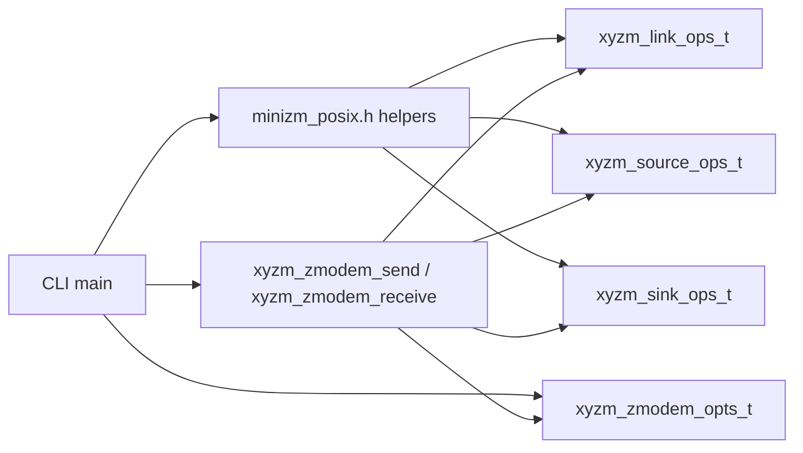
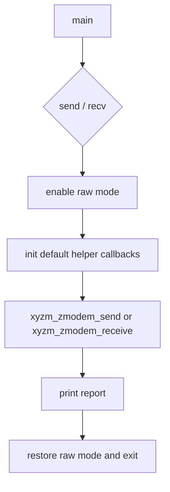

# 同期APIの基本使用例

## 概要

このディレクトリの sample は、`sz` / `rz` のような最小 ZMODEM CLI を `libxyzm` の同期 API で実装する最短経路の例です。
transport、source、sink は `samples/support/minizm_posix.h` の helper をそのまま使い、sample 側は request を組み立てることだけに集中します。

独自 transport を実装した場合の差分は [transport/sync](../../transport/sync) を比較してください。

想定 usage は次の通りです。

```text
minizm-sync send <local-file>
minizm-sync recv <output-dir>
```

## なぜ default helper をそのまま使うのか

- `libxyzm` は protocol engine です。CLI の argument 解析、終了コード、進捗表示、保存先 policy はアプリ側が持ちます。
- 同期 API の `xyzm_zmodem_send()` / `xyzm_zmodem_receive()` は呼び出し thread を転送完了まで占有します。
- `stdin` / `stdout` をそのまま transport に使うなら、`minizm_posix_init_stdio_link()` で `send` / `recv` / `now_ms` をまとめて登録できます。
- 単一 file の送信元と受信先は `minizm_posix_init_file_source()` / `minizm_posix_init_file_sink()` で十分です。
- `stdin` が TTY なら raw mode 化が必要ですが、それも `minizm_posix_tty_guard_*()` が持っています。

つまり「stdio で 1 ファイル送る/受ける」範囲では、独自 callback を書かなくても API の全体像を確認できます。

## 関係図





## ファイル構成

1. [minizm_sync.c](minizm_sync.c) が usage、option、`run_send()` / `run_receive()`、`main()` を持ちます。

## Step 1: default transport/source/sink を直接初期化する

sample は helper の state 型をそのまま stack に置きます。

```c
#include "minizm_posix.h"

minizm_posix_tty_guard_t tty_guard;
minizm_posix_fd_link_t link_state;
minizm_posix_file_source_t source_state;
minizm_posix_file_sink_t sink_state;
```

送信側は次の 2 行で transport と source が揃います。

```c
minizm_posix_init_stdio_link(&link, &link_state);
minizm_posix_init_file_source(&source, &source_state, local_path);
```

受信側も sink を直接初期化するだけです。

```c
minizm_posix_init_stdio_link(&link, &link_state);
minizm_posix_init_file_sink(&sink, &sink_state, output_dir, "received.bin", true);
```

application 側に残る判断は fallback file 名や partial file の削除 policy だけです。

## Step 2: `main` 側は request を組んで entry point を呼ぶ

送信側は次の形です。

```c
static int run_send(const char *local_path) {
  minizm_posix_tty_guard_t tty_guard;
  minizm_posix_fd_link_t link_state;
  xyzm_link_ops_t link;
  minizm_posix_file_source_t source_state;
  xyzm_source_ops_t source;
  xyzm_zmodem_opts_t options;
  xyzm_zmodem_send_request_t request;
  xyzm_transfer_report_t report;
  xyzm_status_t status;

  if (minizm_posix_tty_guard_enable_raw(&tty_guard, STDIN_FILENO) != 0) {
    perror("minizm_posix_tty_guard_enable_raw");
    return 1;
  }

  minizm_posix_init_stdio_link(&link, &link_state);
  minizm_posix_init_file_source(&source, &source_state, local_path);
  fill_default_zmodem_options(&options);

  request.link = &link;
  request.source = &source;
  request.options = &options;
  request.observer = NULL;

  status = xyzm_zmodem_send(&request, &report);
  minizm_posix_tty_guard_restore(&tty_guard);
  print_report("send", &report);
  return status == XYZM_STATUS_OK ? 0 : 1;
}
```

受信側も `source` が `sink` に変わるだけです。

```c
static int run_receive(const char *output_dir) {
  minizm_posix_tty_guard_t tty_guard;
  minizm_posix_fd_link_t link_state;
  xyzm_link_ops_t link;
  minizm_posix_file_sink_t sink_state;
  xyzm_sink_ops_t sink;
  xyzm_zmodem_opts_t options;
  xyzm_zmodem_receive_request_t request;
  xyzm_transfer_report_t report;
  xyzm_status_t status;

  if (minizm_posix_tty_guard_enable_raw(&tty_guard, STDIN_FILENO) != 0) {
    perror("minizm_posix_tty_guard_enable_raw");
    return 1;
  }

  minizm_posix_init_stdio_link(&link, &link_state);
  minizm_posix_init_file_sink(&sink, &sink_state, output_dir, "received.bin", true);
  fill_default_zmodem_options(&options);

  request.link = &link;
  request.sink = &sink;
  request.options = &options;
  request.observer = NULL;

  status = xyzm_zmodem_receive(&request, &report);
  minizm_posix_tty_guard_restore(&tty_guard);
  print_report("recv", &report);
  return status == XYZM_STATUS_OK ? 0 : 1;
}
```

この構成なら、POSIX 環境で同期 ZMODEM CLI を作るための glue はほぼ request 構築だけで済みます。
